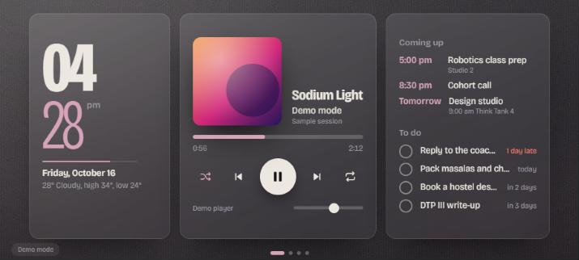
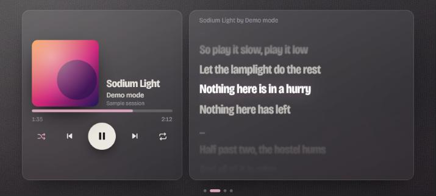
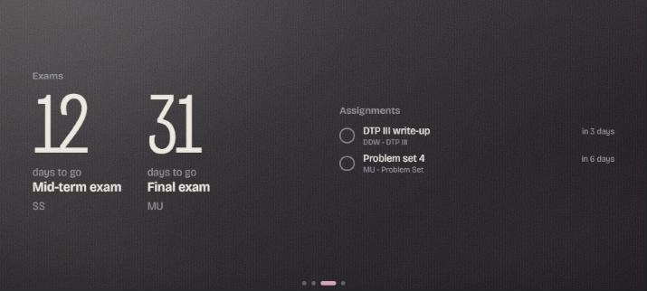
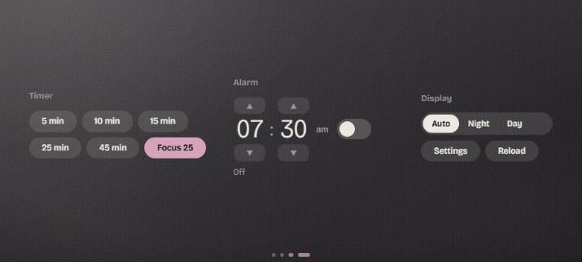

# Desk Dash

**Turn the old phone or tablet in your drawer into an always-on desk display.**


Everyone has a retired phone or tablet lying around: a cracked screen, a dying battery, too slow for daily use, but with a perfectly good display. Desk Dash gives it a second life as a swipeable, landscape dashboard that sits next to your laptop. It shows the time and weather, what's playing on Spotify (with live synced lyrics), today's calendar, your to-do list, exam countdowns, and timers and alarms. It's a single HTML file plus two tiny serverless functions, with no app store, no framework and no build step, so it runs on any device with a browser, even years-old Android.

I built it for my own desk, on a spare Samsung S21 FE, and I'm slowly turning it into something anyone can point at their own old device.

**[Live demo →](https://phone-ui-ebon.vercel.app/?demo)** (demo mode, no accounts needed; best viewed in landscape)

| Home | Player + lyrics |
|---|---|
|  |  |
| **Dates** | **Tools** |
|  |  |

## Features

**Home:** the at-a-glance screen
- Large clock (12/24h) with a minute-progress bar, date, and live weather from Open-Meteo (no API key)
- Upcoming calendar events from any Google Calendar / iCal feed
- To-do list pulled from Notion, sorted by due date with "late / today / in N days" labels; tick a task and it's marked **Done back in Notion**

**Player:** a full Spotify remote
- Album art, progress and seek, play/pause, skip, shuffle, repeat, volume
- The background and accent colour are sampled from the current album cover and cross-fade between tracks
- **Synced lyrics** from LRCLIB that scroll line-by-line with the song, falling back to plain lyrics when synced ones don't exist

**Dates:** the student screen
- Big "days to go" countdowns for upcoming exams
- Assignment list with subject and due dates, also synced with Notion

**Tools**
- One-tap timers (5 / 10 / 15 / 25 / 45 min, plus a Pomodoro "Focus 25")
- Daily alarm with snooze
- Night mode (auto by schedule, or forced on/off) that dims everything for the bedside

**Built for a screen that never turns off**
- Burn-in protection: the layout drifts a few pixels every 4 minutes and returns to Home/Player after 2 minutes idle
- Settings live in an on-device sheet (long-press the clock), stored in `localStorage`, so nothing is hard-coded per user
- `?demo` mode with sample data so anyone can try it without connecting accounts

## How it works

```
Old phone / tablet (kiosk browser, landscape)
  └─ index.html (vanilla JS, no build step)
       ├─ Spotify Web API    ← direct from the device, OAuth PKCE (no client secret anywhere)
       ├─ LRCLIB             ← synced lyrics
       ├─ Open-Meteo         ← weather
       └─ /api/* (Vercel serverless, protected by a shared DASH_KEY header)
            ├─ /api/tasks     → Notion API (read tasks + assignments, write "Done")
            └─ /api/calendar  → your private iCal URL, parsed with node-ical
```

Secrets that can't live on the device (the Notion token and your private calendar URL) stay in Vercel environment variables. The device only holds a shared `DASH_KEY` that the functions check on every request. Spotify uses the PKCE flow, so there's no client secret to leak.

## Tech stack

HTML · CSS · vanilla JavaScript · Vercel Serverless Functions (Node 18) · Spotify Web API · Notion API · node-ical · LRCLIB · Open-Meteo

## Run your own

1. **Fork and deploy.** Import this repo into [Vercel](https://vercel.com), or run `npx vercel` in the folder.
2. **Set environment variables** in Vercel:

   | Variable | What it is |
   |---|---|
   | `DASH_KEY` | Any long random string; you'll type the same one on the device |
   | `NOTION_TOKEN` | From notion.so/profile/integrations; share your Tasks and Assignments databases with the integration |
   | `TASKS_DB`, `ASSIGNMENTS_DB` | Your Notion database IDs |
   | `ICS_URL` | Google Calendar → Settings → *Secret address in iCal format* (keep it private) |

3. **Spotify.** Create an app at [developer.spotify.com/dashboard](https://developer.spotify.com/dashboard), tick *Web API*, and add your deployed URL as a Redirect URI (the Settings sheet shows the exact value). Playback controls need Spotify Premium.
4. **On the old device.** Open your URL, long-press the clock to open Settings, and enter your Spotify Client ID, `DASH_KEY`, and latitude/longitude for weather.

### Making it a proper always-on display (Android)

- Use a kiosk browser such as **Fully Kiosk Browser**: set the start URL, keep the screen on, lock it to landscape, and allow autoplay.
- Turn on *Developer options → Stay awake while charging*. On Samsung, enable *Protect battery* (85% cap) so a phone that's plugged in 24/7 doesn't swell.
- Tap the screen once after launch so the browser allows alarm sounds.

The Notion integration currently expects my database schema (`Task name`, `Due date`, `Status`, `prio`). Adapt `mapTask` / `mapAssignment` in [`api/tasks.js`](api/tasks.js) for yours.

## Roadmap (work in progress)

- [ ] Onboarding flow so setup doesn't require editing env vars
- [ ] Pluggable task sources (Google Tasks, Todoist) beyond my Notion schema
- [ ] Portrait layout for tablets and very small phones
- [ ] PWA manifest + offline cache so it survives flaky Wi-Fi
- [ ] Home-screen widgets: smart-home toggles, transit times, now-playing from any app

## Author

**Parth Sharma**, Computer Science & Design at the Singapore University of Technology and Design (SUTD)
[GitHub](https://github.com/parthsharma00) · [LinkedIn](https://www.linkedin.com/in/parth-sharmasutd) · parthsharma72007@gmail.com
